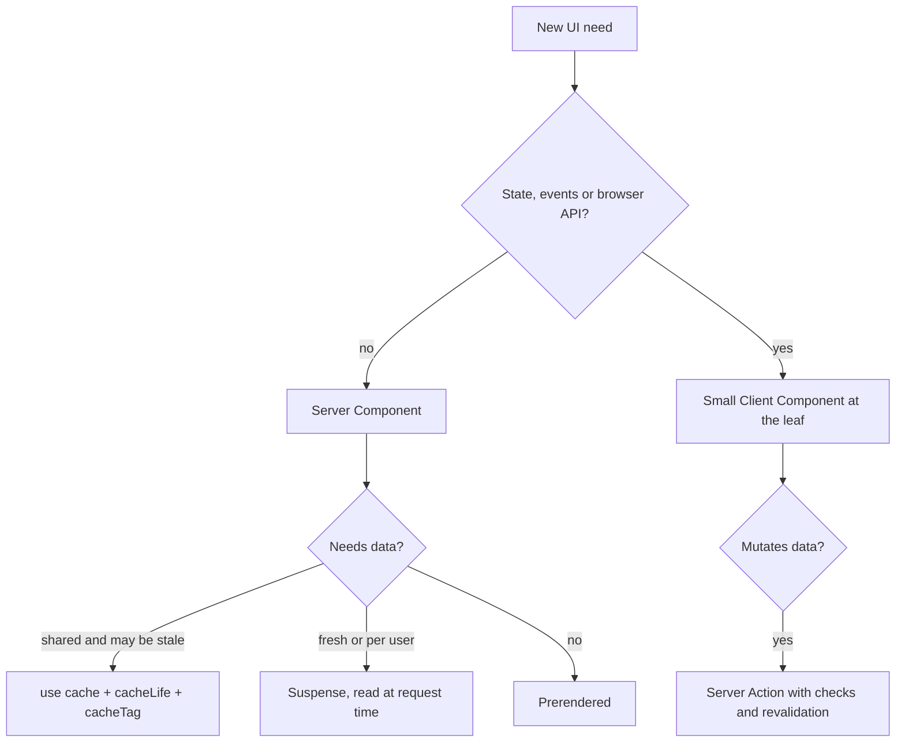

# Next.js Expert

Single source of implementation guidance for Next.js, React and TypeScript in iPonto front-end. Reply to the user in Brazilian Portuguese.

> **Versions:** Next.js 16.4 (App Router, Turbopack, `cacheComponents` and `partialPrefetching` on), React 19.3, TypeScript 5 (strict), Tailwind CSS 4, ESLint 9. Check `package.json` before using an API, and **read the guide in `node_modules/next/dist/docs/`** before writing Next.js code.

## Precedence

1. [nextjs-rules.md](../../rules/nextjs-rules.md) and [code-standards.md](../../rules/code-standards.md)
2. Installed Next.js documentation (`node_modules/next/dist/docs/`)
3. This `SKILL.md`
4. Project layers in this folder
5. External material in `references/`

On conflict, the higher one wins. Known divergences: [External material](#external-material-do-not-apply-directly).

## When to use

- Creating or changing routes, pages, layouts, loading, error and not-found files.
- Writing components, hooks, stores, services and types.
- Fetching, caching and revalidating data; configuring the proxy to the API.
- Server Actions, forms, Route Handlers, `proxy.ts`, sessions and authorization.
- Simplifying recently written code without changing behavior.

## Reference router

Classify the task and load **only** the matching guide. The rules in this file stay active.

```text
Task or changed file
   ├─ route, layout, folder, 'use client', error/loading, metadata, proxy.ts, env
   │     → ARCHITECTURE → architecture.md
   ├─ component, hook, state, key, re-render, Tailwind, Image, Link
   │     → REACT → react-patterns.md
   ├─ fetch, service, cache, revalidation, rewrites, API contract
   │     → DATA → data-fetching.md
   ├─ form, Server Action, Route Handler, validation, error feedback
   │     → FORMS → forms-and-api.md
   ├─ login, session, cookie, role, protected route
   │     → AUTH → authentication.md
   ├─ refactor finished, cleanup without behavior change
   │     → SIMPLIFY → simplify.md
   └─ visual design, hierarchy, typography, motion, UX copy
         → /impeccable
```

### External material by subject

| Subject | Files |
|---------|-------|
| App Router patterns | [app-router-patterns.md](references/app-router-patterns.md) |
| Data fetching and caching | [data-fetching](references/data-fetching/data-fetching.md) · [caching-strategies](references/data-fetching/caching-strategies.md) · [client-fetching](references/data-fetching/client-fetching.md) |
| Server Actions, loading and errors | [server-actions](references/data-fetching/server-actions.md) · [error-loading-states](references/data-fetching/error-loading-states.md) · [error-boundaries](references/data-fetching/error-boundaries.md) |
| TanStack Query (only if adopted) | [react-query.md](references/data-fetching/react-query.md) |
| Clerk (only if adopted) | [server-vs-client](references/clerk/server-vs-client.md) · [middleware-strategies](references/clerk/middleware-strategies.md) · [server-actions](references/clerk/server-actions.md) · [api-routes](references/clerk/api-routes.md) · [caching-auth](references/clerk/caching-auth.md) |
| Auth.js (only if adopted) | [authjs-setup](references/authjs/authjs-setup.md) · [oauth-providers](references/authjs/oauth-providers.md) · [examples](references/authjs/examples.md) |

## Mandatory workflow

1. Trace user action → component → action or service → API → UI before proposing changes.
2. Map the affected routes, layouts, components, hooks, services, types, cache tags, proxy rules and tests.
3. Before writing new code, search the repository for the component, hook or utility that already does it and extend it.
4. Decide per piece: Server or Client Component; prerendered, cached (`use cache`) or streamed (`<Suspense>`).
5. Identify the impact on personal data, secrets, authorization and accessibility.
6. Present the implementation and test plan and **stop until explicit approval**.
7. After approval, for anything new (feature, screen, rule, bug): **RED test before production code** via [`/nextjs-test`](../nextjs-test/SKILL.md), with a **happy and an unhappy path** for each branch. Confirm it fails for the right reason.
8. Implement incrementally in the places of [Where each thing lives](#where-each-thing-lives) until GREEN.
9. **Refactor: finish with [simplify.md](simplify.md)** without changing behavior, accessibility or performance. Re-run only the scoped tests.
10. Run [Validation](#validation).

## Where each thing lives

Details and examples: [architecture.md](architecture.md).

| Order | Place | What it holds |
|-------|-------|---------------|
| 1 | `src/types/` | API contracts and shared types |
| 2 | `src/services/` | Backend access (`server-only` client), parsing and error translation |
| 3 | `src/app/<route>/` | `page`, `layout`, `loading`, `error`, `not-found`, `actions.ts` |
| 4 | `src/app/<route>/_components/` | Components used by one route |
| 5 | `src/components/` | Shared components (`ui/` for generic ones) |
| 6 | `src/hooks/` | Client logic extracted from components |
| 7 | `src/utils/` | Pure functions: formatting, validation |
| 8 | `src/stores/` | Global client state, only when needed |

**Forbidden:** backend URL used in the browser; `fetch` to the backend outside `src/services/`; business logic inside JSX; a Server-only module imported by a Client Component; a new dependency without approval.

## Anti-patterns

- `'use client'` on a page or layout because one button needs a click handler.
- `useEffect` to fetch initial data, or to derive state that can be computed during render.
- Array index as `key` in a dynamic list.
- `any`, `console.log`, empty `catch`, `@ts-ignore` without justification.
- `redirect()` or `notFound()` inside `try`: they throw, and the `catch` swallows them.
- Reading `cookies()`, `headers()`, `params` or uncached data outside `<Suspense>` with Cache Components.
- Caching user-specific data in a shared cache.

**Bad — the whole page becomes client code and calls the backend from the browser**

```tsx
'use client';

export default function EmployeesPage() {
  const [employees, setEmployees] = useState<any[]>([]);

  useEffect(() => {
    fetch('http://localhost:8080/api/v1/employee/list')
      .then((response) => response.json())
      .then(setEmployees);
  }, []);

  return employees.map((employee, index) => <p key={index}>{employee.nome}</p>);
}
```

**Good — server-rendered, streamed, typed, through the service**

```tsx
import { Suspense } from 'react';
import { listEmployees } from '@/services/employee-service';

const EmployeeList = async () => {
  const employees = await listEmployees();

  if (employees.length === 0) {
    return <p>Nenhum funcionário cadastrado.</p>;
  }

  return (
    <ul data-testid="employee-list">
      {employees.map(({ id, nome }) => (
        <li key={id}>{nome}</li>
      ))}
    </ul>
  );
};

export default function EmployeesPage() {
  return (
    <main>
      <h1>Funcionários</h1>
      <Suspense fallback={<p>Carregando funcionários...</p>}>
        <EmployeeList />
      </Suspense>
    </main>
  );
}
```

### Decision flow



## Coding standards

Full list: [code-standards.md](../../rules/code-standards.md). While implementing:

- Arrow functions and named exports; Next.js special files use `export default`.
- Props as `interface`; explicit return types on hooks, services and actions.
- `PageProps<'/route'>`, `LayoutProps<'/route'>` and `RouteContext<'/route'>` are global types generated by `next typegen`.
- `params` and `searchParams` are Promises.
- Imports with the `@/` alias (`@/*` → `src/*`).
- JSDoc in English on complex components, hooks, services and utilities ([jsdoc.md](../nextjs-docs/jsdoc.md)).
- UI text and error messages in Portuguese.

## Validation

```powershell
npx next typegen
npx tsc --noEmit
npx eslint <files>
npx prettier --check <files>
npx jest <file> -t "<test name>"
npm run build
```

- Prettier, Jest and Playwright are dependencies to be approved before the first use; say which check was skipped.
- `npm run build` is what catches Cache Components errors (`next dev` only warns).
- Full test suite only when asked.

## Do / Don't

| ✅ Do | ❌ Avoid |
|------|----------|
| Server Component by default | `'use client'` on layouts and pages |
| Fetch on the server through a service | Browser calling the backend URL |
| `<Suspense>` close to the data | One spinner for the whole page |
| `use cache` with `cacheLife` for shared data | `export const dynamic` / `revalidate` |
| `updateTag` after a Server Action | Hoping the cache expires |
| Check session inside each action and handler | Relying on `proxy.ts` or a layout |
| `<button>`, `<label htmlFor>` | `<div onClick>`, unlabeled input |
| `unknown` + type guard | `any` or blind `as` cast on API data |
| RED happy and unhappy test before code | Happy-path test written afterwards |

## External material: do not apply directly

| External material says | In iPonto |
|------------------------|-----------|
| `middleware.ts`, `export function middleware` | `src/proxy.ts`, `export function proxy` |
| "Proxy/middleware protects the route" | Optimistic redirect only; check in every page, action and handler |
| `fetch(url, { next: { revalidate } })`, `force-cache`, `no-store` as the caching model | Cache Components: `'use cache'`, `cacheLife`, `cacheTag`, `<Suspense>` |
| `export const dynamic`, `revalidate`, `fetchCache` | Removed with `cacheComponents` |
| `unstable_cache` | `'use cache'` |
| `revalidateTag('posts')` | `updateTag(tag)` in Server Actions; `revalidateTag(tag, 'max')` elsewhere |
| `params: { id: string }` | `params: Promise<{ id: string }>` or `RouteContext` |
| `error.tsx` with `error: Error`, `reset` | `error: unknown`, `retry` |
| `<Image priority>` | `preload`, or `loading="eager"` / `fetchPriority="high"` |
| `any`, `as string` on `FormData`, `process.env.X!` | `unknown` + validation |
| Class `ErrorBoundary` | `error.tsx` or `catchError` from `next/error`; no class components |
| `function` keyword for functions (react-typescript skill) | Arrow functions |
| Index as `key`, `[...Array(5)].map((_, i)` | Stable key; for static skeletons use a constant list of ids |
| ORM, Prisma, `db.*` in pages and actions | The data lives in the NestJS API: call a service |
| Server fetch to `/api/...` of the same app | Call the service directly |
| `unauthorized()` / `forbidden()` | Experimental (`authInterrupts`); enable only with approval |
| Packages (`swr`, `@tanstack/react-query`, `zod`, `zustand`, `nuqs`, shadcn/ui, Clerk, Auth.js) | Not installed; need approval |
| Vitest examples | Jest ([`/nextjs-test`](../nextjs-test/SKILL.md)) |

## Related skills

Load these without waiting for the prompt to name them.

| Situation | Load | Required |
|-----------|------|----------|
| Fix or feature | [`/nextjs-test`](../nextjs-test/SKILL.md): RED before code, happy and unhappy | Yes |
| After every refactor | [simplify.md](simplify.md) | Yes |
| New or redesigned screen, UI polish | [`/impeccable`](../impeccable/SKILL.md) | Yes for visual work |
| New public component, hook or service; ADR | [`/nextjs-docs`](../nextjs-docs/SKILL.md) | Yes for complex ones |
| Before finishing a PR | [`/nextjs-review`](../nextjs-review/SKILL.md): [quality-gate.md](../nextjs-review/quality-gate.md) | Yes |
| Input, session, cookie, redirect, secret | [security.md](../nextjs-review/security.md) | Yes |
| Personal data | [lgpd.md](../nextjs-review/lgpd.md) | Yes |
| Forms, modals, navigation | [accessibility.md](../nextjs-review/accessibility.md) | Yes |
| Measured slowness or large bundle | [performance.md](../nextjs-review/performance.md) | When measured |

## Cross-references

Rules: [nextjs-rules.md](../../rules/nextjs-rules.md) · [code-standards.md](../../rules/code-standards.md). Project: [CLAUDE.md](../../../CLAUDE.md). Catalog: [skills/README.md](../README.md).
